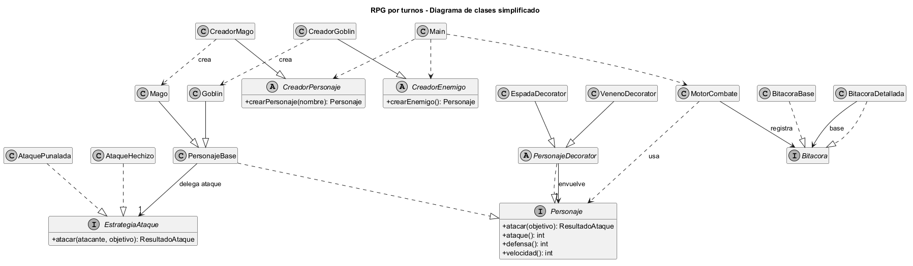
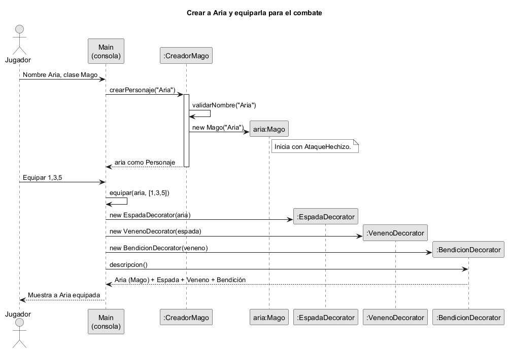

# Meta 3.2 - Patrones de diseño

## ¿Qué hace el juego?

Es un RPG por turnos en consola. Puedes jugar como Guerrero, Mago, Arquero o Pícaro y escoger entre un Goblin, un Esqueleto y un Brujo. Antes de pelear puedes combinar equipo; en cada turno puedes atacar, defenderte o gastar una de tus dos pociones. La pelea termina cuando uno se queda sin puntos de vida (HP).

## Cómo jugar

Con un JDK 17 o más reciente, abre una terminal en la carpeta del proyecto:

```text
javac -encoding UTF-8 -d out src/*.java
java "-Dfile.encoding=UTF-8" -cp out Main
```

Los objetos se escriben por número y separados por comas. Por ejemplo, `1,3,5` equipa espada, veneno y bendición en ese orden. Con `0` no agregas equipo. La opción de bitácora detallada agrega bloqueo, críticos y un resumen del combate.

## Cómo usé los patrones

| Patrón | Dónde se usa y por qué |
| --- | --- |
| Strategy | `EstrategiaAtaque` separa la espada, el hechizo, la flecha y la puñalada. Cada personaje trae su forma de atacar y el motor no tiene que preguntar de qué clase es para calcular el golpe. |
| Factory Method | Los creadores de héroes y enemigos definen los métodos `crearPersonaje` y `crearEnemigo`. Por ejemplo, `CreadorMago` construye el mago con sus atributos y su hechizo; el menú recibe un `Personaje`. |
| Decorator | Cada pieza de equipo envuelve al personaje anterior. La armadura aumenta la defensa; el veneno sube el ataque, añade daño directo y deja daño durante dos turnos. La bendición multiplica ataque, defensa y velocidad por 1.15, así que ponerla antes o después de una bonificación cambia el resultado. También envolví la bitácora básica para agregarle detalles sin tocar el motor. |

La estrategia recibe al personaje con todo su equipo, no al personaje base. Así, el mago sigue usando hechizo aunque se equipe con espada, pero el cálculo sí incluye la bonificación de la espada.

## Diagramas

En el diagrama de clases aparecen algunos creadores y decoradores como ejemplo. La secuencia muestra cómo se crea a Aria y se le agrega equipo antes de iniciar una pelea.





[Código PlantUML de clases](uml/clases.puml) · [Código PlantUML de secuencia](uml/creacion.puml)

## Pruebas

El archivo [EJECUCION.txt](EJECUCION.txt) tiene tres partidas corridas en consola con distintos equipos y enemigos. La prueba de código verifica, entre otras cosas, que las capas de equipo sí cambien el daño y que cambiar de estrategia no quite el equipo.

```text
javac -encoding UTF-8 -cp out -d out pruebas/PruebaPatrones.java
java "-Dfile.encoding=UTF-8" -cp out PruebaPatrones
```

Material de consulta: instrucciones de la Meta 3.2 y [GoFPattern](https://www.gofpattern.com/).
